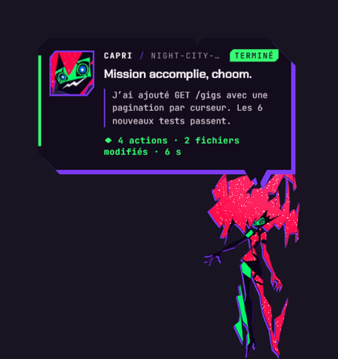
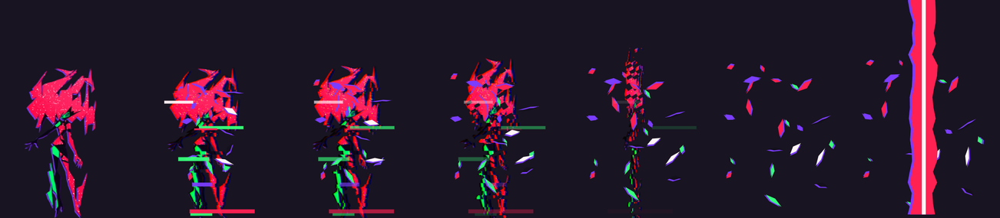
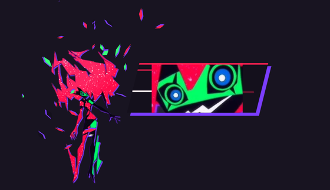
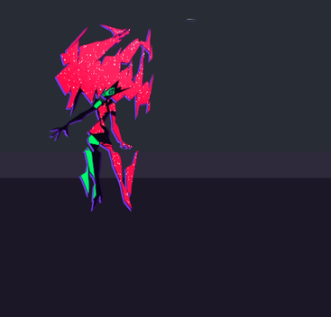
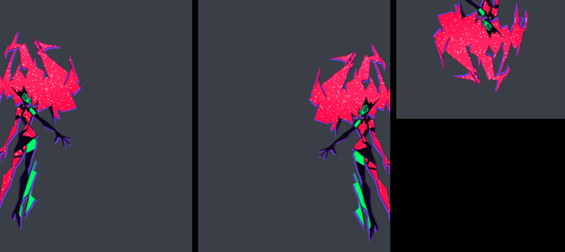

**English** · [Français](README.fr.md)

# Capri

Capri, the *Project Capricorn* construct from Cyberpunk: Edgerunners season 2, lives on your desktop
and tells you what **Claude Code** is up to. She teleports, glitches, comments on every action,
comes to find you when Claude needs your permission, and loses it when the job is done.





## What she does

- **While Claude works**: a ticker over her head shows the current action
  (`EDITS gigs.ts`, `RUNS npm test`, `GREPS "paginate"`…) and she sheds little data glyphs.
- **When Claude needs you** (permission, question): she teleports next to your mouse, mane bristling, and won't let it go.
- **When a command fails**: red impact frame, she gets knocked back, heavy glitch, and the error line that actually matters.
- **When it's done**: she teleports to the middle of the screen, laughs with her mane blown wide,
  an anime cut-in of her grin, then a summary (`12 actions · 3 files changed · 2m 14s`) and Claude's last sentence.
- **The rest of the time**: she floats, her mane sways and sheds shards, she drifts from one corner to another,
  turns around and cocks her head when your mouse comes near, sometimes looks up at a star (the satellite),
  and falls asleep after 10 quiet minutes.



### She gets around

- **She sits on your windows**: perched on the top edge of a window, legs dangling and kicking one after the other.
  She rides along when you move the window, and falls off when you close, minimize or cover it.
  While Claude works she settles on the window in front if she can.
- **She peeks in from the edges of the screen**: half hidden on the left or right, or hanging upside down from the top.
  She's shy: get your mouse close and she ducks away to another edge.
- **She falls**: stretched, mane blown up, accelerating, then a big squash and a shower of shards when she lands.
  On the way down, a window ledge can catch her.
- **Drop her on a window**: drag her and let go with her hips on a window's top edge, she sits there.
  Let go anywhere else and she falls.
- **Little flourishes**: a full spin with afterimages, a hop, looking left and right, the cocked head.





Window tracking is Windows-only for now (a tiny PowerShell helper reads window positions, no titles, no contents).
On macOS and Linux she still floats, peeks, falls and wanders.

She only catches the mouse on her actual body (pixel-precise): the rest of the screen works as usual.

- **Click** her: she tells you where Claude is at.
- **Drag** her: move her around.
- **Click** the panel: it closes.
- **Ctrl+Alt+C**: hide her / bring her back.
- **Tray icon** (next to the clock): teleport, demo, size, sound, screen, language, start with Windows, hooks.

She speaks **French or English and picks the language of your system** on her own. You can force one from the tray menu.

## Install

You need [Node.js](https://nodejs.org) 20 or newer.

```bash
git clone https://github.com/mochiiwuff/capri-desktop.git
cd capri-desktop
npm install
npm start
```

### Hook her up to Claude Code

Click Capri's tray icon, then **Install Claude Code hooks**. Or from the command line:

```bash
npm run hooks:install
```

This adds a hook to `~/.claude/settings.json` (a backup is written next to it, your existing hooks are kept).
Restart your Claude Code sessions afterwards. To remove it: `npm run hooks:uninstall`.

The hooks run `async`: they never slow Claude down, and when Capri isn't running they do nothing.

### Try it without Claude

```bash
npm run demo
```

Replays a fake session from start to finish (reads, writes, a failing test, a permission prompt, the end).
It's also in the tray menu.

## Sounds

Every sound is synthesized live (Web Audio), nothing copyrighted ships with the repo.
You can drop your own files in the custom sounds folder (tray › Sound › *Open custom sounds folder*),
named like this (`.mp3`, `.wav`, `.ogg` or `.m4a`):

| File | When |
|---|---|
| `teleport-out` | she vanishes |
| `teleport-in` | she reappears |
| `done` | Claude is done |
| `alert` | Claude is waiting for your permission |
| `error` | a command failed |
| `hello` | a session starts |
| `star` | she looks up at the satellite |
| `land` | she lands after a fall |
| `blip` | every syllable while she talks |
| `tick` | a quiet reminder |

## What leaves your machine

Nothing. The hook only keeps what the display needs (tool name, file path, command, the start of your prompt and
of Claude's last message, all truncated) and sends it to `127.0.0.1` only.
Your file contents are never sent: for a write, only its size goes through.

## Art direction

The goal: she should feel like she stepped out of the anime, not like a widget.

- **Cel animation**: her body is redrawn 12 times a second ("on twos") like anime, 24 during teleports.
  Every drawing has a slight *boil* (the wobble of a line redrawn by hand).
- **Frame by frame, pose to pose**: nothing is tweened. Each move is an exposure sheet (`acting.js`):
  key drawings held for a few frames, an anticipation the other way, a smear frame with multiples of
  the head, an overshoot, holds. Her idle float is four drawings, not a sine wave.
- **She acts with her head and her mane**, like in the show: the cocked head, the shards bristling or
  blowing wide, the manic laugh with the head shaking on every drawing, the slump when she sleeps.
  The cut-out is rigged so her head tilts around the neck, her mane flares unevenly around a rigid face,
  and her thighs fold (foreshortened, seen from the front) so she can sit with her lower legs swinging.
- **Squash and stretch, afterimages**: the flat cut-out squashes to a sliver to turn around, stretches when
  she falls, flattens when she lands, and splits into green and red copies (the other minds in her) when she spins or laughs.
- **The satellite**: now and then she stares at a star above the screen, a nod to the season's ending.
- **Her texture**: the red mane is pushed back to the show's hot red and covered in twinkling white specks.
  Shards come loose from it and drift away.
- **The violet offset**: like in the anime, a misregistered violet copy under her, under the panel, under the shards.
- **"Relic" glitch**: shifted horizontal slices and RGB split, in the spirit of Johnny Silverhand's appearances.
- **Teleport**: charge, shards, collapse into a line, a red column of light to the sky,
  a bolt to the destination, back with two *impact frames*.
- **Cut-in**: her real grin, pushed in, with speed lines, when Claude finishes a job.
- **Type**: Chakra Petch (bevelled cuts, like her shards) + JetBrains Mono for data.

If Windows is set to "Show animations: off", she sticks to fades.

## How it's built

```
hooks/capri-hook.js      run by Claude Code, reads the event on stdin and posts it to the app
scripts/install-hooks.js adds / removes the hook in ~/.claude/settings.json
src/main/                Electron: full-screen transparent click-through window, tray, local HTTP bridge
  windows.js / .ps1      where the other windows are (Windows only), so she can sit on them
src/renderer/js/
  sprite.js              WebGL shader: head tilt, mane flare, sitting, smears, afterimages, colors, glitch
  acting.js              the exposure sheets: every move, drawing by drawing
  capri.js               the character: stances, teleport, sitting, peeking, falling, drag, sleep
  fx.js                  shards, light columns, bolts, glyphs, the star, the cut-in
  panel.js               the "transmission" panel and the ticker
  brain.js               turns Claude events into lines and actions
  lines.js               what she says (FR / EN)
  voice.js               the sounds
```

To hack on it: `npm run dev` turns on debug routes on the bridge (`/debug/capture` saves a frame of the window to `captures/`).

## Credits and rights

Capri / Project Capricorn, Cyberpunk and Cyberpunk: Edgerunners belong to CD PROJEKT RED, Studio Trigger and Netflix.
This is a non-commercial fan project with no affiliation. The character images in `assets/capri/` come from frames of
the show and a fan-made cut-out; they are **not** covered by the code's MIT license.
If a rights holder wants them removed, open an issue.

Fonts: Chakra Petch and JetBrains Mono, under the SIL Open Font License, via Fontsource.
